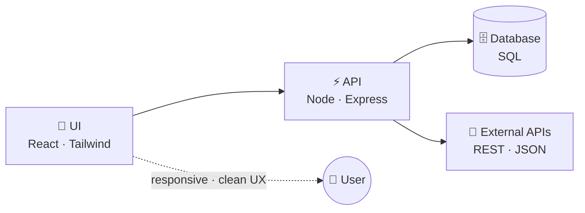

<!-- ===================== HERO ===================== -->
<div align="center">


<a href="https://github.com/Nattapon2005">
  
</a>

<br/><br/>


</div>


<!-- ===================== ABOUT ===================== -->
<div align="center">
  
</div>

```ts
// profile.ts
const nut: Developer = {
  name:    "Nut",
  role:    "Full Stack Web Developer",
  level:   "3rd-year student · building real-world projects",
  stack:   ["React", "TypeScript", "Node.js", "Express", "PHP", "SQL"],
  passion: ["Scalable web apps", "Intuitive UI", "RESTful APIs", "Software architecture"],
  now:     ["Next.js", "Prisma", "Docker", "Cloud & CI/CD"],
  lookingFor: "Internship · Junior roles · Freelance projects",
  motto:   "Code. Create. Improve. Repeat.",
};
```

I turn ideas into **responsive, user-friendly web applications**, from the interface people see to the API and database behind it. I learn by shipping projects and making each one better than the last.


<!-- ===================== TECH STACK ===================== -->
<div align="center">
  
</div>

<div align="center">

| 💻 Languages | 🎨 Frontend | ⚙️ Backend | 🛠️ Tools |
|:---:|:---:|:---:|:---:|
|  |  |  |  |

### 🔭 Currently Exploring


</div>

### 🧩 How I build



<details>
<summary><b>📋 Full skill breakdown (click to expand)</b></summary>
<br/>

| Area | Skills |
|---|---|
| 🎨 **Frontend** | React, Vite, Tailwind CSS, Bootstrap, SCSS, Responsive Design, UI/UX Implementation |
| ⚙️ **Backend** | Node.js, Express.js, PHP, RESTful API Development, API Integration, CRUD |
| 🗄️ **Database** | SQL, Relational Database Fundamentals |
| 🔧 **Tools** | VS Code, Git & GitHub |
| 📚 **Learning** | Next.js, Prisma ORM, MySQL & PostgreSQL, Docker, Python, Java, Auth & Web Security, Cloud Deployment, CI/CD |

</details>


<!-- ===================== PROJECTS ===================== -->
<div align="center">
  
</div>

<table>
<tr>
<td width="50%" valign="top">

### 🛒 E-commerce Web App

> Interactive online store with a smooth shopping flow.

- 🛍️ Dynamic product display
- 🧺 Add / remove / update cart items
- 📱 Responsive on desktop & mobile
- ✨ Interactive, clean interface


[](https://my-wed-template-github-io.onrender.com/)

</td>
<td width="50%" valign="top">

### 📦 Product API Website

> Fetches and renders product data from JSON and external APIs.

- 🔌 Fetch from JSON & external APIs
- ⚡ Async JavaScript (`async/await`)
- 🧩 Dynamic content rendering
- 📱 Responsive components


[](https://github.com/Nattapon2005?tab=repositories)

</td>
</tr>
</table>

<div align="center">

[](https://github.com/Nattapon2005?tab=repositories)

</div>


<!-- ===================== STATS ===================== -->
<div align="center">
  
</div>

<div align="center">


</div>


<!-- ===================== ROADMAP ===================== -->
<div align="center">
  
</div>

```diff
+ [DONE]    HTML · CSS · JavaScript · TypeScript fundamentals
+ [DONE]    React · Node.js · Express · REST API basics
+ [DONE]    Responsive UI with Tailwind / Bootstrap / SCSS
! [ACTIVE]  Next.js · Prisma ORM · MySQL & PostgreSQL
! [ACTIVE]  Authentication & Web Security
- [NEXT]    Docker & containerization
- [NEXT]    Cloud deployment & CI/CD
- [NEXT]    Professional & freelance projects
```

<div align="center">

| 🚀 | 🔐 | 🧱 | ☁️ | 🌍 |
|:---:|:---:|:---:|:---:|:---:|
| Become a **Professional Full Stack Dev** | Build **secure & scalable** apps | Design reliable **backends & APIs** | Master **databases, cloud & deploy** | Ship projects with **real impact** |

</div>


<!-- ===================== CONTACT ===================== -->
<div align="center">
  
</div>

<div align="center">

<!-- TODO: replace with your real email & LinkedIn -->
[](https://github.com/Nattapon2005)
[](mailto:your.email@example.com)
[](https://www.linkedin.com/in/your-profile)

<br/>

### 💡 *"Code. Create. Improve. Repeat."*

<sub>Always learning. Always building. Open to opportunities.</sub>


</div>
